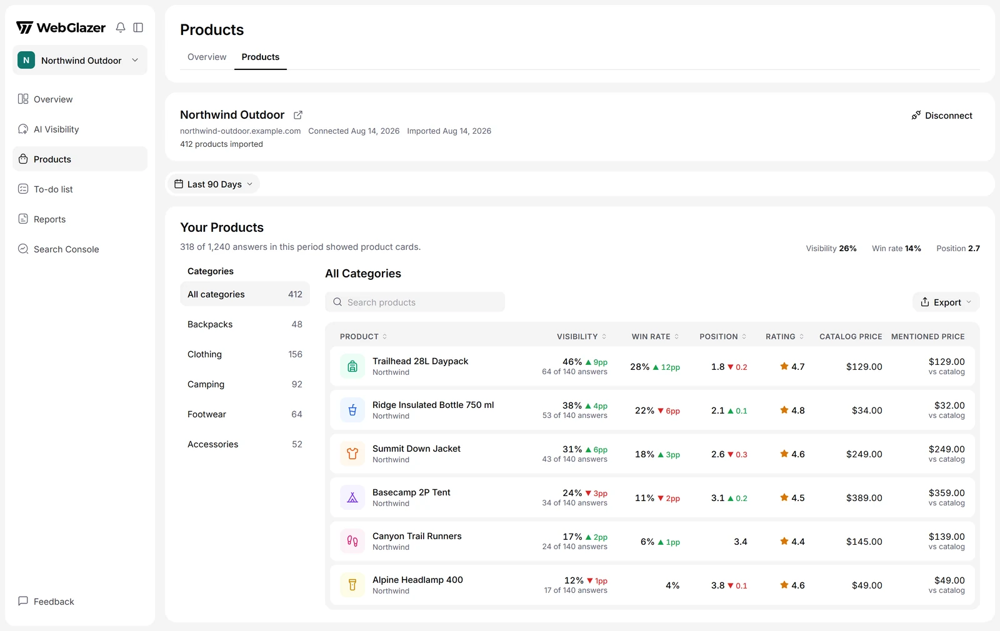

The **Products** page shows AI visibility for each product in your Shopify store. It tells you which products appear in the product cards of AI shopping answers, how often they come first, and which competing products and shops show up beside them.

<Frame caption="Illustration with sample data">
  
</Frame>

## Who has Products

Products is included in the Standard, Advanced and Agency plans, and in the Basic trial. A paid Basic plan has no Products. Without access there is no **Products** item in the sidebar, and a connected AI agent cannot read product data either. If you lose access, your imported data is kept and shown again when access returns.

## Connect your Shopify store

<Steps>
  <Step title="Open Products">
    Click **Products** in the sidebar, right below **AI Visibility**.
  </Step>
  <Step title="Enter the store address">
    Under **Connect your Shopify store**, check the store address. It starts filled with your brand's website.
  </Step>
  <Step title="Connect">
    Click **Connect store**. WebGlazer reads the store's public product feed, so there is nothing to install in Shopify.
  </Step>
</Steps>

The first import shows its progress (**Waiting to start**, **Checking the store**, **Reading products**) and usually takes under a minute. You can leave the page while it runs.

Only a **Company Admin** can connect or disconnect the store. Everyone else sees a note that a Company Admin can connect it.

Limits:

- One store per brand.
- The first 1,000 products in the store are tracked. Click **View untracked products** to see the ones that are not.
- Password-protected stores and stores with bot protection cannot be imported.

The store imports once when you connect it. To import it again, disconnect and reconnect it.

## Where product numbers come from

WebGlazer reads the shopping product cards that AI engines show when they answer your prompts, and matches each card to a product in your catalog. Product numbers update after each daily run. If none of your prompts got an answer with product cards, the page says **No product cards yet**.

## Overview tab

**Products** > **Overview** sums up the period chosen in the filter bar:

- **Brand Visibility**: how often each brand shows up in the product cards of your shopping answers, over time, with a **Top Brands** table. Your own brands are tagged **You**.
- **Performance by Visibility**: your products AI shows most and least.
- **Shopping Queries**: the shopping searches AI ran to pick the products in its answers.
- **Query Fanouts**: the web searches AI ran while writing your shopping answers.
- **Merchants**: the shops AI points shoppers to in its product cards.
- **Sources**: the websites AI read while answering your shopping prompts.

Lists have **Top**, **Trending**, **Losing** and **New** tabs. A category pill on the filter bar narrows the Overview to one product category.

## Products tab

**Products** > **Products** lists every tracked product with:

- **Visibility**: the share of shopping answers to this product's prompts that showed it.
- **Win rate**: the share of its appearances where the product was the first card.
- **Position**: its average card position. Lower is better.
- **Rating**, **Catalog price** and **Mentioned price** (the price AI quoted).
- **Merchants**, **Competing brands** and **Competing products**.
- **Top shopping queries**, **Top query fanouts** and **Appearances**.

Sort by any column, search by title, and export the list as CSV or JSON. **Categories** on the left filter by Shopify product type and show that category's visibility. Products with no type are under **Uncategorised**.

## A single product

Click a product to open its page. It shows:

- How the product was matched, and a link to it in your store.
- **Visibility & Win Rate** over time and **Competing Products**.
- **Position vs Competitors**: where this product and its most frequent competitors sit in the product cards.
- **Merchants**, **Sources**, **Shopping Queries** and **Query Fanouts** for answers that showed this product.
- **Prompts & Chats**: the prompts and answers this product appears in, and where it came first.

## Disconnect the store

Click **Disconnect** in the store header and confirm. Product tracking stops. The imported catalog is kept hidden and past product results stay. Reconnecting the same store brings the catalog back and imports it again.
