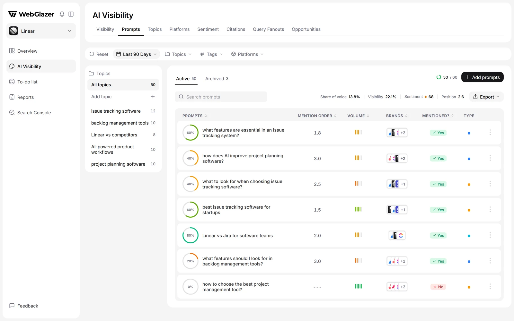
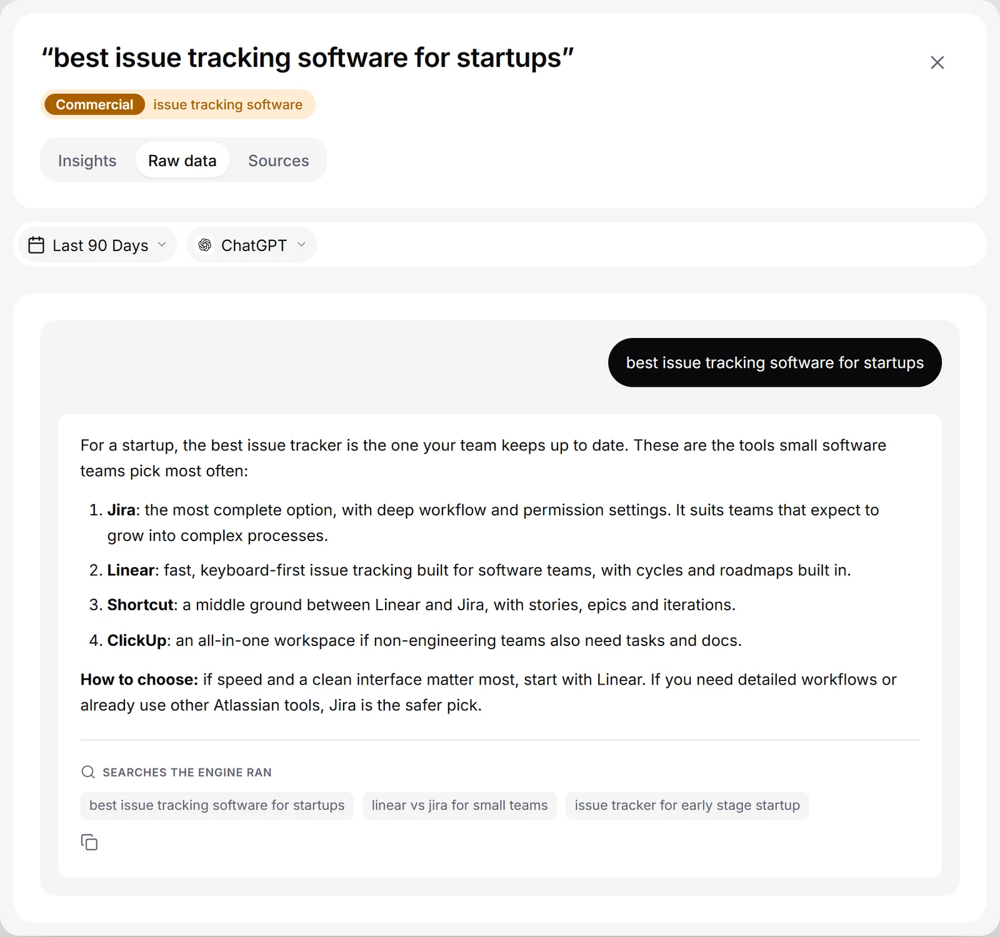

The **Prompts** tab lists every question you track and how AI answered it. Use it to find the prompts where you are missing, then open one to read the exact answers.

Open it from **AI Visibility** > **Prompts**.

<Frame caption="Illustration with sample data">
  
</Frame>

## Your numbers above the table

A line above the table shows your own brand across the prompts in view: **Share of voice**, **Visibility**, **Sentiment** (with a dot in the band color) and **Position**. They follow the page filters and date range. See [Share of Voice](/metrics/share-of-voice), [Visibility](/metrics/visibility), [Sentiment](/metrics/sentiment) and [Mention order](/metrics/mention-order) (shown here as **Position**).

## Topic rail

On wide screens a rail on the left lists **All topics** and each topic with its number of active prompts. Click a topic to filter the table, and the rest of **AI Visibility**, to it. On smaller screens, editors get a **Manage topics** button instead. Adding, renaming and archiving topics is covered in [Prompts and topics](/setup/prompts-and-topics).

## Active and Archived

Two tabs sit above the table:

- **Active**: the prompts WebGlazer runs. This is the default.
- **Archived**: prompts you stopped tracking. Their last results stay visible and you can **Restore** them.

Next to the tabs you see your prompt allowance as "used / allowance" and the **Add prompts** button. When you reach the limit, you get **Upgrade plan** and **Manage prompts** instead.

## The table

Use **Search prompts** to filter rows by text.

| Column | What it shows |
| --- | --- |
| **Prompts** | The question. The ring next to it is your [Visibility](/metrics/visibility) for that prompt, as a whole percent. |
| **Mention order** | Average place where AI first names your brand in the answers to this prompt. 1 = named first. See [Mention order](/metrics/mention-order). |
| **Volume** | The monthly Google search volume for the closest matching keyword, found when WebGlazer wrote the prompt. Prompts you write yourself show "No keyword data". |
| **Brands** | Your brand and the competitors you track that AI named when answering this prompt. Hover to spread the logos. |
| **Mentioned?** | **Yes** if any answer in the period named you, **No** if none did, **Unknown** if there is no usable answer yet. |
| **Type** | The prompt's search intent as a colored dot, for example **Informational**, **Consideration**, **Transactional** or **Branded**. Hover for its meaning. |

All numbers cover every run in the selected date range, with the filters applied.

- Click a column header to sort. Each click cycles ascending, descending, off.
- A prompt that has never run reads **Not run yet**. A prompt with no answer in the selected range reads **No result in this period**.
- **Branded** prompts get a **Mentioned?** verdict but no visibility ring and no mention order, because they name you in the question.
- Editors can select rows to archive them in bulk, and use each row's menu for **Edit prompt** and **Archive prompt**.
- **Export** downloads every AI answer in the period and filters as CSV or JSON, one row per answer, with columns such as Prompt, Type, Topic, Model, Ran at, Brand mentioned, Sentiment, Competitors, Citation URLs, Fan-out queries and Answer.

## The prompt detail sheet

Click any prompt row to open its detail sheet. It shows the prompt text, its type and its topic at the top, and has three tabs: **Insights**, **Raw data** and **Sources**.

You can also reach the sheet from other tabs:

- **Sentiment** tab: click a quote. The sheet opens on **Raw data** for that engine, with the quote highlighted.
- **Query Fanouts** tab: click a search. The sheet opens on **Raw data** for the engine that ran it.
- A link in a report opens the prompt on that engine's raw answer.

The sheet has its own date pill. On **Insights** and **Sources** a models pill picks which engines the numbers cover (**All models selected** by default). On **Raw data** an engine picker picks whose answer you read.

### Insights

- Three cards: **Mention order**, **Sentiment** and **Volume**.
- **Visibility Over Time**: your visibility on this prompt across the period. A branded prompt shows "Prompts that name your brand get a yes/no mention, not a visibility score." instead.
- **Top Brands**: your brand and the tracked competitors named for this prompt, with **Visibility** (share of this prompt's answers where the brand showed up), **Sentiment**, **Mention order** and **Sources** (how many AI engines named the brand for this prompt).

### Raw data

<Frame caption="Illustration with sample data">
  
</Frame>

The full answer one engine gave, shown as a chat: your prompt, then the answer. It shows the newest successful answer from that engine in the period. Use the copy button to copy the answer text.

Under the answer you may see what else the engine returned: **Searches the Engine Ran** (its fan-out searches), **Sponsored**, **Products**, **Places** and **Videos**. A section shows only when the engine returned it.

### Sources

"Pages the AI answers cited for this prompt, across every engine. A source cited by more engines is more worth your attention." Each row shows the page title and site, its **Category** and **Mentions** (how many times it was cited). Click a row to open the page.
