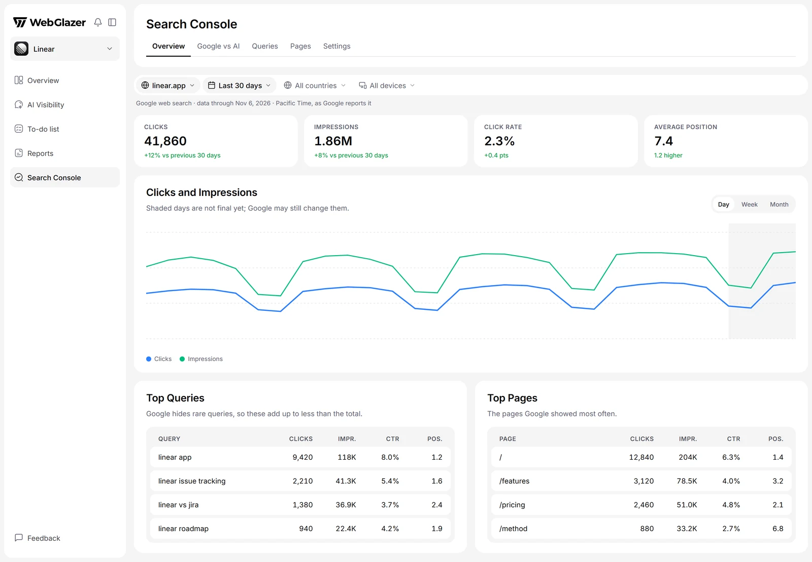

The **Search Console** page puts your Google search data next to how AI answers cite the same pages. It shows which pages rank on Google but are ignored by AI, and which pages AI cites but Google barely shows.

<Frame caption="Illustration with sample data">
  
</Frame>

## Connect Google Search Console

Only a **Company Admin** can connect. Anyone else with access to the brand sees the data once it is connected.

<Steps>
  <Step title="Open Search Console">
    Click **Search Console** in the sidebar.
  </Step>
  <Step title="Sign in with Google">
    Click **Connect with Google** and sign in with a Google account that has your website in Search Console. On Google's screen, tick "View Search Console data for your verified sites" before you continue.
  </Step>
  <Step title="Choose websites">
    In **Choose Websites to Track**, every website on the account starts ticked. Untick the ones you do not want, or click **Only this** next to one. Then click **Save N websites**. You can track up to 50 websites.
  </Step>
</Steps>

WebGlazer has read-only access and never changes anything in Search Console. The connection belongs to the brand you are viewing.

After you save, the **First Import** loads 16 months of Google data, newest days first. You can leave the page while it runs. After that, WebGlazer collects new days every day.

### If connecting fails

- **Nothing was connected**: you declined access on Google's screen. Try again.
- **Google didn't give access to Search Console**: the Search Console box was not ticked. Try again and tick it.
- **Your Google Workspace admin has blocked this app**: ask your Workspace admin to allow it, or use a personal Google account that has the website.
- **This Google account has no Search Console websites**: add the site in Search Console first, or click **Use a different account**.

## Filters

Every tab shares the filters at the top: the website, the date range (**Last 7 days**, **Last 30 days**, **Last 3 months**, **Last 6 months**, **Last 12 months** or **Last 16 months**; default **Last 30 days**), countries and devices.

Dates are Google's days in Pacific Time, as Google reports them. Google finalizes its numbers about 3 days later, so recent days are shaded on charts and may still change. Google counts each website separately, so numbers for two websites are never added together.

## Overview

- **Clicks**, **Impressions**, **Click Rate** and **Average Position** for the period, with the change from the period before.
- **Clicks and Impressions** over time, by **Day**, **Week** or **Month**.
- **Top Queries** and **Top Pages**. Google hides rare queries, so top queries add up to less than the total.
- **Clicks by Country** and **Clicks by Device**.

## Google vs AI

This tab compares Google with the AI answers to your tracked prompts. It has two lists:

- **Ranking on Google, Not Cited by AI**: pages with at least 1,000 impressions on Google's first page and fewer than 2 AI citations. These pages already earn Google traffic but AI does not use them as sources.
- **Cited by AI, Barely on Google**: pages with at least 5 AI citations and under 100 impressions, or an average position worse than 20.

Each page shows **AI retrievals**, **AI citations**, **Last crawled** and **Index status** from Google's page inspection, for example **Indexed as declared**, **Google picked another URL**, **Soft 404** or **Blocked by robots.txt**.

This tab ignores the country and device filters.

## Queries and Pages

**Queries** and **Pages** each show the top 5 over time, then a full table (**All Queries**, **All Pages**) you can sort and search.

## Settings tab

A Company Admin manages the connection on **Search Console** > **Settings**:

- **Google Account**: the connected account. **Sign in again** reconnects it.
- **Tracked Websites**: tick or untick websites and click **Save changes**.
- **Disconnect**: WebGlazer stops collecting Google data and stops accessing Search Console. The Google data already imported stays, and so do prompts you already added from Search Console.
- **Remove Search Console**: deletes every Google number imported for this brand and disconnects the account. Type the name shown to confirm, then click **Remove and delete data**. To use it again you start from scratch.

If Google access expires, a **Connection expired** banner appears and collection pauses. Click **Reconnect** to pick up where it stopped.

## Search Console in other places

- **AI Visibility** > **Prompts** > **Add prompts** > **Google Search Console** turns question-style Google searches into prompt suggestions. See [Prompts and topics](/setup/prompts-and-topics).
- **Settings** > **Integrations** shows the connection status. It reads the same connection as the **Search Console** page.
