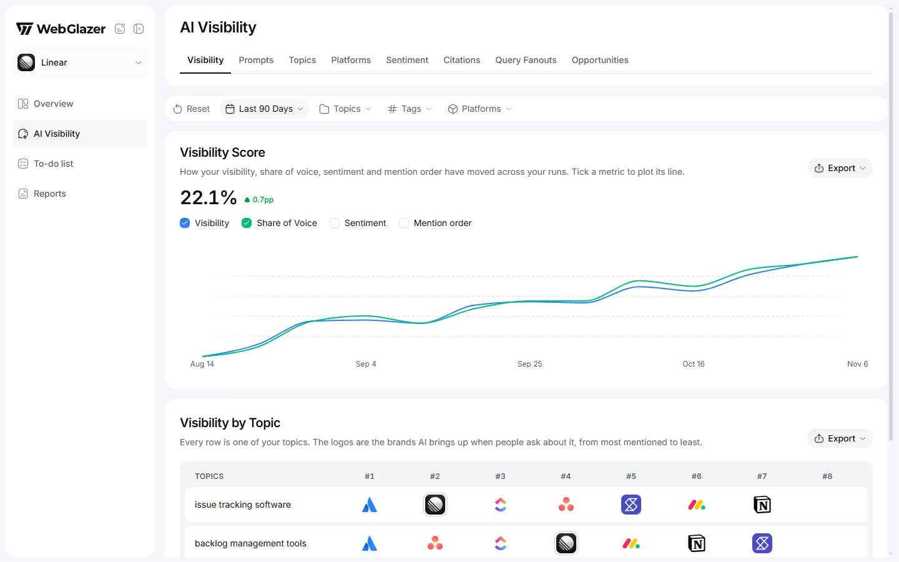
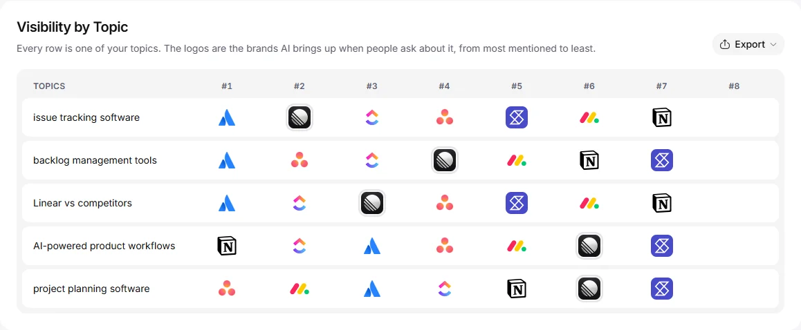

The **Visibility** tab is the first tab of **AI Visibility**. It answers: how visible is my brand right now, how has that moved, and who leads each of my topics?

Open it from **AI Visibility** in the sidebar. It opens on **Visibility** by default.

<Frame caption="Sample data based on a linear.app project">
  
</Frame>

## Tabs and filter bar

**AI Visibility** has eight tabs: **Visibility**, **Prompts**, **Topics**, **Platforms**, **Sentiment**, **Citations**, **Query Fanouts** and **Opportunities**. The filter bar under them (date, **Topics**, **Tags**, **Platforms**, **Reset**) is shared by all tabs, so a selection carries over when you switch. See [Overview](/dashboard/overview#filter-bar) for what each filter does.

On this tab the branded topic and the **Branded** tag are hidden, because every number here is a rate that branded answers cannot produce.

## Visibility Score

"How your visibility, share of voice, sentiment and mention order have moved across your runs. Tick a metric to plot its line."

- **The big number** is your [Visibility](/metrics/visibility) for the selected period and filters.
- **The chip** next to it is the change in percentage points (pp) against the previous period of the same length. If there is nothing to compare with, it says so.
- **Metric checkboxes**: **Visibility**, **Share of Voice**, **Sentiment** and **Mention order**. **Visibility** and **Share of Voice** are ticked at first. Tick a box to add its line. At least one line always stays on. A box only shows for a metric that has data in the period.
- **The chart** has no Y axis on purpose. The four metrics use different scales, so each line is stretched to the full height to show its shape. Hover a point to read the real values. The **Mention order** line is flipped, so up always means better on every line.
- **Points per period**: one point per day for ranges up to 35 days and for **All time**, one per week up to 120 days, one per month above that. Several runs on one day are pooled into one point. Days without a run are skipped.
- With a single run in the period you see bars instead of lines. With none, "Not enough runs yet".
- **Export** downloads the points as CSV or JSON with the columns Date, Visibility %, Share of Voice %, Sentiment and Mention order.

## Visibility by Topic

"Every row is one of your topics. The logos are the brands AI brings up when people ask about it, from most mentioned to least."

<Frame caption="Sample data based on a linear.app project">
  
</Frame>

- Each row is one topic. Columns **#1** to **#8** hold the brands ranked in that topic, best first. Your own brand's logo has a double outline so you can spot it down each column.
- Hover a logo to see the brand name.
- Topic rankings use the same order as **Rankings** on [Overview](/dashboard/overview#how-brands-are-ranked), applied to that topic's answers. Every tracked brand AI names ranks here, with no minimum number of answers. Brands you do not track are left out. See [Competitors](/setup/competitors).
- If a brand is hidden by a filter, its slot stays empty instead of shifting the others left.
- **Export** downloads one row per topic with the brand name in each slot.
- On a phone, each topic collapses to a card with its top brands.

## Empty states

- "No visibility data yet" means no answer in the period could be counted. It fills in after your next daily run.
- "No runs match your filters." means no run falls inside the filters. Reset them.
