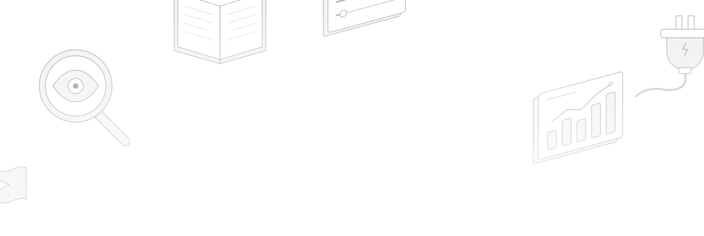
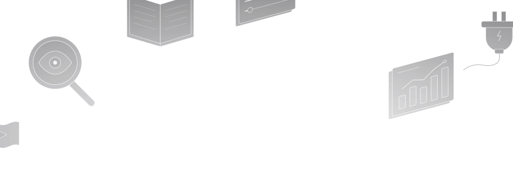

export const HeroCard = ({ filename, title, description, href }) => {
  return (
    <>
      <Visibility for="humans">
        <a className="group cursor-pointer pb-8" href={href}>
          
          
          <h3 className="mt-5 text-gray-900 dark:text-zinc-50 font-medium">
            {title}
          </h3>
          {description}
        </a>
      </Visibility>
      <Visibility for="agents">
        <Card title={title} href={href}>
          {description}
        </Card>
      </Visibility>
    </>
  );
};

  <Visibility for="humans">
    

      
      
    

  </Visibility>

  

    <h1 className="block text-4xl font-medium text-center text-gray-900 dark:text-zinc-50 tracking-tight">
      Documentation
    </h1>

    

      WebGlazer shows you how AI assistants talk about your brand.
    

    

      <HeroCard filename="quickstart" title="Quickstart" description="Go from sign up to your first results." href="/quickstart" />

      <HeroCard
        filename="concepts"
        title="Core concepts"
        description="Brands, prompts, topics, engines, runs and credits in plain words."
        href="/concepts"
      />

      <HeroCard
        filename="visibility"
        title="Metrics"
        description="Visibility, Share of Voice, mention order, sentiment and citations."
        href="/metrics/visibility"
      />

      <HeroCard
        filename="dashboard"
        title="Dashboard overview"
        description="Read the Overview, Prompts, Platforms and the other pages."
        href="/dashboard/overview"
      />

      <HeroCard
        filename="setup"
        title="Setup"
        description="Prompts, topics, competitors, engines, brands and your team."
        href="/setup/prompts-and-topics"
      />

      <HeroCard
        filename="mcp"
        title="Connect your AI agent"
        description="Connect your own AI agent to your WebGlazer data."
        href="/integrations/mcp"
      />
    

  

  

## What WebGlazer tracks

WebGlazer shows you how AI assistants talk about your brand. Every day it asks ChatGPT, Perplexity, Google AI Mode, Gemini and Copilot the questions your buyers ask, then shows where you are named, which competitors win instead, and which sources the answers cite.

WebGlazer collects answers from five AI engines:

- ChatGPT
- Perplexity
- Google AI Mode
- Gemini
- Copilot

WebGlazer asks each engine your prompts every day and records the answers. Results update once a day. The Basic plan tracks any 3 of these engines. Standard and Advanced track all 5. Agency plans choose 1 to 5. See [Plans and billing](/account/plans-and-billing).

For each answer, WebGlazer records whether your brand is named, where it appears in the answer, the tone used about it, which competitors are named, and which web pages the engine cites.

## Use these docs with AI

Every page in these docs is also available in formats an AI assistant can read:

- **[llms.txt](https://webglazer.com/docs/llms.txt)**: an index of every docs page with a one-line description.
- **[llms-full.txt](https://webglazer.com/docs/llms-full.txt)**: the full text of every page in one file.
- **Markdown pages**: add `.md` to the end of any page URL to get it as plain Markdown, for example `https://webglazer.com/docs/quickstart.md`.
- **Docs MCP server**: connect an AI client to `https://webglazer.com/docs/mcp` so it can search these docs.

The docs MCP server only searches these docs. To let an AI agent read your own brand data, use the [WebGlazer MCP server](/integrations/mcp).

  

