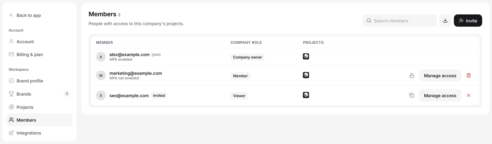

Invite teammates so they can read or work on your brands. Each person gets one role in your company, and Viewers and Members only reach the brands you pick for them.

## Roles

| What they can do | **Viewer** | **Member** | **Company Admin** |
| --- | --- | --- | --- |
| Projects they reach | The selected projects | The selected projects | Every company project |
| Read results | Yes | Yes | Yes |
| Keep their own [To-do list](/dashboard/todo) | Yes | Yes | Yes |
| Connect an AI agent through the [MCP server](/integrations/mcp) | Yes | Yes | Yes |
| Edit content, prompts, topics, competitors and tracking | No | Yes | Yes |
| Invite and manage teammates | No | No | Yes |
| Change billing and the plan | No | No | Yes |
| Change a brand's time zone | No | No | Yes |
| Connect Google Search Console or a Shopify store | No | No | Yes |
| Delete projects | No | No | Yes |

The **Owner** is the person who created the company. The owner holds the subscription and has full access.

An AI agent connected through the MCP server sees only the brands that person can see.

## Invite a teammate

<Steps>
  <Step title="Open Members">
    Go to **Settings** > **Members** and click **Invite**.
  </Step>
  <Step title="Pick a role">
    Choose **Viewer**, **Member** or **Company Admin**. For a Viewer or Member, tick the **Projects** they should reach. A Company Admin reaches every project, so there is nothing to tick.
  </Step>
  <Step title="Send it">
    Enter their **Email** and click **Create invite**. WebGlazer emails the invite, and only that email address can accept it.
  </Step>
</Steps>

If the email cannot be sent, WebGlazer shows the invite link so you can copy it and send it yourself.

### Share a link instead (Viewers only)

For a Viewer, tick **Create a shareable link instead (Viewer only)** and click **Create link**. Anyone who opens the link joins as a Viewer of the selected projects. The link works once.

Every invite, by email or by link, expires after 7 days.

## Accept an invite

1. Open the link from the invite email.
2. If you are not signed in, click **Continue with Google**, or **Use email instead** to sign in with email and password.
3. Check which company or brands you are joining and with which role, then click **Accept invite**.

If the page says **This invite link is invalid or has expired**, ask a Company Admin to send a new one.

## See and manage your team

**Settings** > **Members** lists everyone with access: each **Member** (email, status and whether MFA is on), their **Company role** and their **Projects**. Use **Search members** to filter, or the download button to export the list as CSV. Pending invites show an **Invited** badge.

<Frame caption="Illustration with sample data">
  
</Frame>

A **Company Admin** has these actions on each row:

- **Manage access**: change the role and the projects in **Edit access**.
- **Copy invite link**: for a pending invite.
- **Suspend access** and **Restore access**: block someone for now without removing them.
- **Revoke invite**: cancel an invite that was not accepted.
- **Remove from company**: removes the person from every project of the company. They lose access at once.

The owner's access cannot be changed or removed.

Viewers and Members see only the people on their current project and cannot invite anyone.

## Leave a company

If you were invited, click **Leave company** in **Settings** > **Members**. You lose access to every project of that company; its projects and billing do not change. To come back, a Company Admin has to invite you again.

The owner cannot leave. To hand the company over, the owner clicks **Request ownership transfer** to pick a Company Admin, or uses **Contact support to transfer ownership**.
